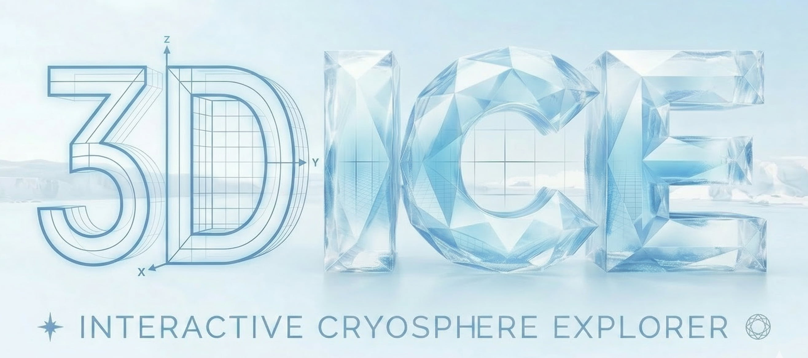
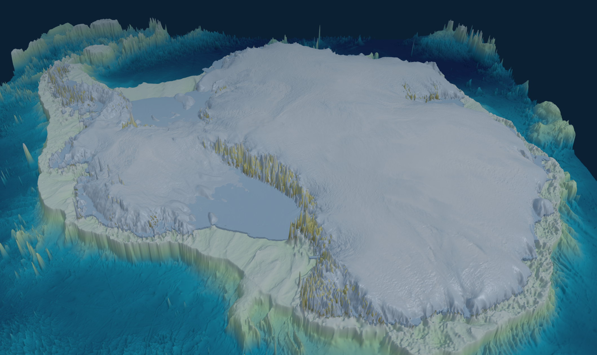

<p align="center">
  <picture>
    <source media="(prefers-color-scheme: dark)" srcset="static/tools/3d-ice-logo.jpg">
    <source media="(prefers-color-scheme: light)" srcset="static/tools/3d-ice-logo-light.jpg">
    
  </picture>
</p>

<h1 align="center">3D ICE</h1>

<p align="center">
  <a href="https://github.com/yuwang115/3d-ice/actions/workflows/ci.yml"></a>
  <a href="https://github.com/yuwang115/3d-ice/actions/workflows/draft-pdf.yml"></a>
  <a href="LICENSE"></a>
</p>

<p align="center">
  <strong>Interactive 3D Cryosphere Explorer for Antarctica and Greenland</strong>
</p>

<p align="center">
  3D ICE turns state-of-the-art cryosphere datasets into an explorable browser experience for
  research communication, teaching, and public engagement.
</p>

<p align="center">
  <a href="https://3d-ice.com/">Website</a>
  ·
  <a href="https://3d-ice.com/explore/">Explore with the guided tour</a>
  ·
  <a href="https://3d-ice.com/tools/3D-interactive-cryosphere-explorer.html">Research edition</a>
  ·
  <a href="https://github.com/yuwang115/3d-ice/releases">Releases</a>
</p>

## Overview

3D ICE is a standalone source repository for the full 3D ICE experience: the GitHub Pages site,
the interactive browser runtime, bundled cryosphere datasets, preview media, and the preparation
scripts used to turn scientific source data into web-ready assets.

The project is designed to bridge rigorous glaciological research and public curiosity. It lets
people rotate, zoom, and layer Antarctica and Greenland datasets directly in the browser, then jump
from the visualization to the underlying source products.

<p align="center">
  <a href="https://www.youtube.com/watch?v=J81vJ7ODy6I">
    
  </a>
  <br>
  <sub>
    <strong>Click to watch</strong> the full 3D ICE demo on YouTube.
  </sub>
</p>

## Two editions

3D ICE comes in two editions that share one runtime:

| Edition | Pages | For | What it offers |
| --- | --- | --- | --- |
| Public | [`/explore/`](https://3d-ice.com/explore/), [`/zh/explore/`](https://3d-ice.com/zh/explore/) | Everyone: visitors, classrooms, outreach stands | Each region's default terrain, animated ice flowlines coloured by speed, ocean currents, sea level, the ice-free rebound (the ice melts away over three seconds the first time it is switched on) and Antarctica's projected future to 2300, with a nine-stop guided tour and a plain-language explainer, with sources, for every layer. |
| Research | [`/tools/3D-interactive-cryosphere-explorer.html`](https://3d-ice.com/tools/3D-interactive-cryosphere-explorer.html), `/zh/tools/…` | Researchers | Every dataset, resolution and layer, the data-snapshot panel, flowline profiles, the idealised rebound models and the recording mode. |

## What you can explore

| Region | Layers |
| --- | --- |
| Antarctica | Bed topography, surface elevation and ice thickness (BedMachine Antarctica v4 or Bedmap3), grounding line, refined drainage basins, ice velocity, basal friction, subglacial hydrology, WAOM2 ocean streamlines, RISE basal melt and thermal driving, isostatic rebound, ISMIP6 projections to 2300, observed surface elevation change (1995–2026) and observed sea ice (1978–2026) |
| Greenland | Bed topography, surface elevation and ice thickness (BedMachine Greenland v6 or QRF), grounding line, basin boundaries (Mouginot & Rignot's regions or Mankoff's outlet catchments), the ITS_LIVE V02.1 velocity mosaic (2014–2024), basal friction, Arctic ocean streamlines, isostatic rebound and observed sea ice (1978–2026) |

Balanced presets support mobile touchscreens, while HD options target larger desktop displays.
The research edition's *Data and sources* list links the source products of the datasets in
view, and the public edition's explainers cite them. [docs/data-layers.md](docs/data-layers.md)
describes every layer, its source products and how it is prepared, and
[DATA_LICENSES.md](DATA_LICENSES.md) gives each data package's licence and terms.

## Getting started

### In the browser (no install needed)

Visit the [public edition](https://3d-ice.com/explore/) or the
[research edition](https://3d-ice.com/tools/3D-interactive-cryosphere-explorer.html) in a
WebGL-capable browser (Chrome or Edge 89+, Firefox 114+, Safari 15+), or serve `static/` locally:

```bash
python3 -m http.server 4173 --directory static
# open http://127.0.0.1:4173/explore/ or http://127.0.0.1:4173/tools/3D-interactive-cryosphere-explorer.html
```

### For development

You need Python 3.10 or newer, and Node.js 22.12 or newer for the JavaScript tests. The
runtime itself has no npm dependencies.

```bash
git clone https://github.com/yuwang115/3d-ice.git
cd 3d-ice
python3 -m venv .venv
source .venv/bin/activate
python -m pip install -e ".[dev]"
python -m pytest tests/ --ignore=tests/e2e     # Python unit and integration tests
npm run test:js                                 # JavaScript unit, data-contract and example tests
```

The browser tests, rebuilding the data packages, the compatibility bundle and releases are in
the [development guide](docs/development.md).

### Worked examples

`node examples/isostatic-rebound.mjs` reproduces the isostatic-rebound figures the explorer shows
for Antarctica, with the explorer's own decoder and rebound module, and
`node examples/ismip6-projection.mjs` reports the grounded-ice loss and implied sea-level rise
of the ISMIP6 projections to 2300, for the whole ice sheet and by drainage basin.
[docs/example.md](docs/example.md) walks through both and through a rebuild of part of the
data pipeline from the repository alone.

## Documentation

| Document | Contents |
| --- | --- |
| [docs/data-layers.md](docs/data-layers.md) | What each layer shows, its source products and how it is prepared |
| [docs/development.md](docs/development.md) | Setup, tests, rebuilding data, the compatibility bundle, deployment, releases and the repository layout |
| [docs/example.md](docs/example.md) | Worked examples that run from a clean clone |
| [docs/architecture.md](docs/architecture.md) | The two-stage design, module boundaries, deployment and verification |
| [docs/data-contract.md](docs/data-contract.md) | The binary and metadata format every data package follows |
| [docs/data-pipeline.md](docs/data-pipeline.md) | Where each package's source product comes from and how to rebuild it |
| [DATA_LICENSES.md](DATA_LICENSES.md) | The licence and terms of every data package |
| [CHANGELOG.md](CHANGELOG.md) | Changes by release |

## Citation

Until an archival DOI and the JOSS paper are available, cite the latest tagged
software release. The repository also includes a machine-readable
[`CITATION.cff`](CITATION.cff) file for GitHub's **Cite this repository** menu.

```bibtex
@misc{wang2026_3dice,
  author  = {Wang, Yu and Lin, Yucheng},
  title   = {{3D ICE}: An Interactive Browser-Based Cryosphere Explorer for Antarctica and Greenland},
  year    = {2026},
  version = {0.4.0},
  url     = {https://github.com/yuwang115/3d-ice/releases/tag/v0.4.0}
}
```

## Contributing and support

We welcome contributions! Please see [CONTRIBUTING.md](CONTRIBUTING.md) for guidelines.
Questions, bug reports and feature requests go to
[GitHub Issues](https://github.com/yuwang115/3d-ice/issues).

This project follows the [Contributor Covenant Code of Conduct](CODE_OF_CONDUCT.md).

## License

The code is licensed under the [MIT License](LICENSE). The data packages in `static/tools/data/` are
not: each stays under its source dataset's licence and terms, listed in
[DATA_LICENSES.md](DATA_LICENSES.md). The WAOM2 ocean streamlines are redistributed with the
written permission of F. Boeira Dias.
